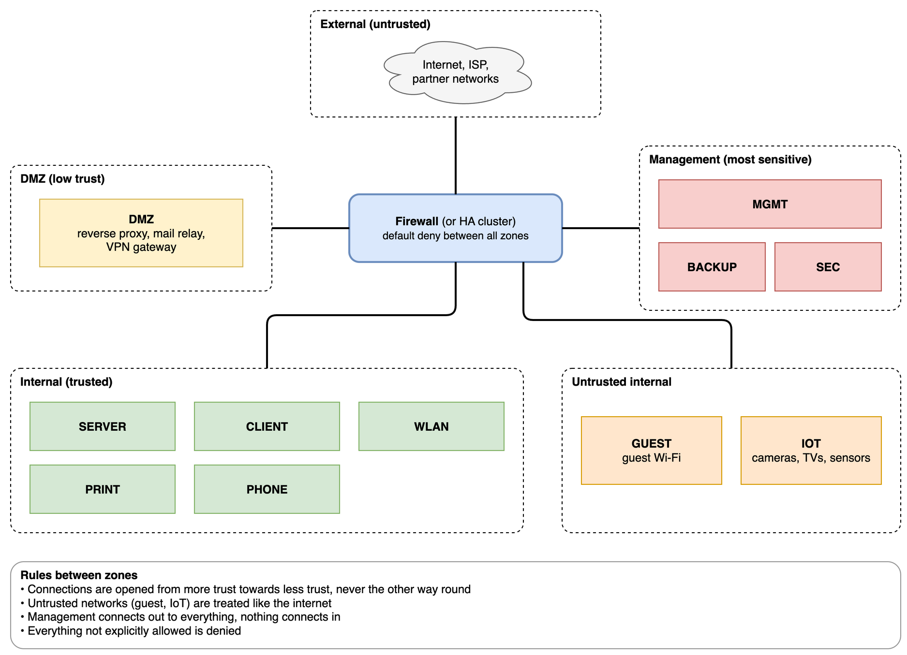

## Introduction

At work I do a lot of firewall migrations and network restructurings for small and mid-sized companies, and in almost every one of them network segmentation comes up. Usually we suggest it; only a few customers ask for it themselves. Some end up with a clean VLAN layout and a tight rule set. For others we decide to postpone it until the new firewall is in place, which is sometimes the better choice. One thing I have learned is that there is no universal layout for every infrastructure. **Which separation makes sense depends heavily on the size and the context of the network.** A small office, a school with hundreds of iPads and a building automation network with thousands of controllers need very different things.

In my opinion a properly segmented network, together with a proper firewall rule set, is one of the biggest security features any infrastructure can have. I live and work in Germany, where laws like NIS2 (in Germany the NIS2UmsuCG) and standards like the BSI IT-Grundschutz or ISO 27001 more or less require it by now. This article is not about the regulations, though. It is about the practice: zones and segments, typical segments, who may talk to whom, and how a segmentation project runs. Customer names and anything identifying are left out.

## What segmentation is and why

Network segmentation means splitting one network into several smaller ones and putting a firewall between them. Devices that belong together sit in the same segment. Everything that wants to cross from one segment to another has to pass the firewall, and the firewall only lets through what you have explicitly allowed.

The reason is simple. Sooner or later something in your network gets compromised: a laptop with a malicious attachment, a printer with ten-year-old firmware, a camera nobody remembers buying. In a flat network that device can talk to everything else, including the domain controller, the NAS and the backup server. In a segmented network it can only reach what its segment is allowed to reach. Segmentation does not stop the first infection. It limits how far an attacker (or e.g. ransomware) can move afterwards, the so-called *lateral movement*, and it makes the blast radius smaller. A device should only be able to connect to what it actually needs. This is a key concept of zero-trust.

## Zones and segments

The document I keep coming back to is the IT-Grundschutz module [NET.1.1 "Netzarchitektur und -design"](https://www.bsi.bund.de/SharedDocs/Downloads/DE/BSI/Grundschutz/IT-GS-Kompendium_Einzel_PDFs_2023/09_NET_Netze_und_Kommunikation/NET_1_1_Netzarchitektur_und_design_Edition_2023.pdf?__blob=publicationFile&v=3) from the BSI (*Bundesamt für Sicherheit in der Informationstechnik*, the German federal office for information security). It is free, only ten pages and very concrete, and a lot of what follows is based on it.

People (me included) use "network", "VLAN", "zone" and "segment" more or less interchangeably. NET.1.1 is stricter about it, and the difference helps: a **zone** is a large area with a clear trust level, like the internal network, the DMZ or the internet. A **segment** is a subdivision *inside* a zone, e.g. clients, servers and printers inside the internal network, and in practice usually a VLAN. Zones can also be other logical groupings of networks, like TRUSTED, UNTRUSTED or WIFI. What matters is that every network belongs to exactly one zone, and the zone tells you how much you trust it.

### Start with the zones

Before I think about VLANs, I think about zones. They are the coarse structure, and the segments are filled in afterwards. The model I use is based on the BSI (NET.1.1 and the older ISi-LANA study) and looks like this:

| Zone | Trust | What lives there |
|---|---|---|
| External | untrusted | the internet, the ISP, partner and customer networks |
| DMZ | low | servers reachable from the internet: reverse proxy, mail relay, VPN gateway |
| Internal | trusted | the segments for servers, clients, printers, phones, … |
| Untrusted internal | untrusted | guest Wi-Fi, IoT, devices you don't control |
| Management | most sensitive | management interfaces of network devices and hypervisors, monitoring, logging, backup |

A few rules follow from that:

- **Traffic is initiated from more trust towards less trust, not the other way round.** Clients may open connections into the DMZ. A server in the DMZ never opens a connection into the internal network. The BSI is explicit here: systems must not access the internal network from the internet or the DMZ.
- **Untrusted networks are treated like the internet.** The BSI puts it exactly like that, and I find it the most useful rule of all. A guest Wi-Fi is physically inside your building, but from a security point of view it is the internet. It gets internet access and nothing else.
- **Management is the most sensitive zone.** Whoever reaches the management interfaces of the switches, the firewall and the hypervisors owns the network. More on that in the communication matrix.

Many firewalls know zones as a concept and let you write rules between zones instead of between single interfaces (on OPNsense, interface groups do a similar job). Even if yours doesn't, writing the zones down keeps the rule set consistent.

One honest remark: the BSI wants at least three *physically* separated zones and a two-tier firewall between the internet and the internal network. In the small and mid-sized companies I work with, I almost never see that. Usually one firewall (or one HA cluster) handles all zones, and the separation between them is logical. That is a compromise, and it's good to know that it is one.

### VLANs separate, firewall rules protect

Ten VLANs that are all routed to each other with an "allow any" rule are not segmentation. They are a flat network with extra steps. The security comes from the rule set between the segments, and that rule set should start with *deny everything* and then open what is needed. This is true for IPv4 and IPv6 alike. If you run both, every rule has to exist for both, otherwise the IPv6 side is wide open next to a carefully built IPv4 rule set.

## Typical segments

This is the standard layout we use at work. The IDs are just a convention, but using the same ones everywhere helps a lot when you look after many networks: MGMT is VLAN 50 at almost every customer, and nobody has to think about it.

| VLAN | Segment | Zone | What goes in |
|---|---|---|---|
| 10 | SERVER | Internal | Servers, VMs, NAS, domain controller. Often simply the old flat network, see below. |
| 20 | CLIENT | Internal | Wired laptops and desktops |
| 30 | WLAN | Internal | Company devices on Wi-Fi, with the same rules as CLIENT |
| 40 | GUEST | Untrusted internal | Guest Wi-Fi: internet only, nothing internal |
| 50 | MGMT | Management | Switches, access points, firewall, hypervisor management, iLO/iDRAC. VLAN 1 is disabled; the switches' management interfaces live here. |
| 60 | PRINT | Internal | Printers: old firmware, rarely updated, but every client needs them |
| 70 | PHONE | Internal | IP phones and the PBX, often with their own provider and QoS |

Where needed, more segments come on top:

- DMZ for servers that are reachable from the internet. Nothing in the DMZ may open a connection into the internal zones.
- BACKUP for the backup server and its storage. Ransomware goes for the backups first, and like management, the backup server connects out to everything while nothing connects in. That's why I count it as part of the management zone.
- SEC for a vulnerability scanner, also in the management zone (more on that below).
- IoT and building technology: cameras, smart home devices, building automation, the Apple TVs in a school. Devices you can't patch or trust get a cage of their own in the untrusted zone.

In bigger networks, DNS, DHCP and the domain controllers get their own INFRA segment, as the BSI suggests. In the small and mid-sized offices I work with, the domain controller usually lives in SERVER and the firewall often does DHCP.

A few things I want to point out:

- The hypervisor appears twice. Its management interface (the Proxmox or vCenter UI, the iLO) belongs to MGMT, its VMs to SERVER or wherever they fit. Otherwise the hypervisor becomes the bridge between your segments, exactly what the BSI warns about.
- DMZ is not GUEST. The DMZ is for *servers* you expose to the internet. Untrusted *clients* go to GUEST or the IoT segment. Nobody plugs a laptop into the DMZ.
- You don't need all of them. In general every group of devices could get its own network, but every additional segment means more rules, more DHCP scopes and more things that break. A handful of segments with a strict rule set is better than twenty with sloppy ones.

## The communication matrix

The table of segments is only half of the concept. The other half is the question of who may talk to whom. I write this down as a matrix: rows are the source, columns the destination, and every cell that is not explicitly allowed is denied.

| from \ to | MGMT | SERVER | CLIENT / WLAN | PRINT | PHONE | BACKUP | SEC | IOT | GUEST | DMZ | Internet |
|---|---|---|---|---|---|---|---|---|---|---|---|
| **MGMT** | ✔ | ✔ | ✔ | ✔ | ✔ | ✔ | ✔ | ✔ | – | ✔ | updates only |
| **SERVER** | – | ✔ | – | print ports | – | – | – | – | – | – | restricted |
| **CLIENT / WLAN** | – | DNS, AD, app ports | ✔ | print ports | – | – | – | specific | – | specific | ✔ |
| **PRINT** | – | DNS, scan to share | – | ✔ | – | – | – | – | – | – | – |
| **PHONE** | – | – | – | – | ✔ | – | – | – | – | – | SIP provider only |
| **BACKUP** | hypervisor API | pull | – | – | – | ✔ | – | – | – | – | – |
| **SEC** | scan | scan | scan | scan | scan | scan | ✔ | scan | – | scan | HTTPS updates |
| **IOT** | – | – | – | – | – | – | – | ✔ | – | – | vendor cloud only |
| **GUEST** | – | – | – | – | – | – | – | – | ✔ | – | ✔ |
| **DMZ** | – | – | – | – | – | – | – | – | – | ✔ | ✔ |

A few rules that are behind this matrix:

**Management connects out, nothing connects in.** MGMT may reach every segment it administers. Nothing from another zone initiates a connection into MGMT, except an admin workstation or jump host that is itself in a protected segment. BACKUP and SEC live in the management zone themselves, so when the backup server pulls VM backups through the hypervisor's management interface, that traffic stays inside the zone. The BSI's management requirements go even further and split the management area into several segments of its own, which is a bit much for a small office.

**The backup server pulls.** Production systems should not be able to write to or delete from the backup storage. The backup server connects to the servers (and to the hypervisor for VM backups) and pulls the data. If ransomware encrypts the file server, it can't reach the backups from there.

**Egress matters too.** The matrix is not only about inbound traffic. IoT devices only need their vendor's cloud, printers don't need the internet at all, and DNS from clients should go to your own resolver, not to whatever is hardcoded in the device.

A real example: we run a vulnerability scanner as a small VM in a dedicated SEC segment at several customers. Its rules are short: SEC to all segments except GUEST allows ping and the services the scanner needs, SEC to the internet allows only HTTPS for updates, and everything towards SEC is denied. That is about as clean as a matrix row gets.

## How a segmentation project runs

Designing VLANs is the fun part. Moving devices is where the time goes. The biggest segmentation project I did was an office building with four floors, around ten rooms per floor, a switch per floor and a printer in almost every room. The target was MGMT, SERVER, CLIENT and PRINTER networks.

**The inventory is the most important part.** Either you are well prepared and have documented (almost) every device and the switch port it is connected to, or you spend hours running around the building trying to figure out which device is plugged into which port. In that project we first documented every device with MAC address, IP address and switch port, and got the floor plans of the building. At another customer the "core switch" turned out to be an unmanaged switch in the kitchen, and nobody knew how the cabling ran. That project starts with discovery, not with VLANs. An article by the CMU Software Engineering Institute (SEI) has a good point here: aim for *good enough* information, not perfect information, or you never get started.

Then comes the plan: classify the devices, define zones and segments, and write the communication matrix. Start with the most critical systems instead of trying to redesign everything at once.

One practical tip: **build the rules on aliases first.** Before we moved a single device, we created aliases for "clients", "printers", "file server" and so on, and wrote all the new rules against them while everything was still in the flat network. When the devices moved to their new VLANs, we only had to change what the aliases contained, not the rules.

What we did during the move, and what I would do again:

- **Keep the old flat network as the server VLAN.** We simply renamed it. Servers kept their IP addresses, which avoids a lot of trouble with hardcoded IPs, DNS entries and licences bound to addresses. I have used this trick at almost every customer since.
- **Clients are easy.** They get their address by DHCP, so you change the VLAN on the switch port and they come back in the new network.
- **Printers are the hardest part.** Each printer got a new IP, a new hostname and had to be updated (or recreated) on the print server. We gave them a naming scheme with floor and number in the hostname and the same digits in the last octet of the IP (`…-og3-04` gets `.34`), so you can tell the address from the label.
- **Label every wall socket.** We labelled all of them: the first port in every room `PRT`, the others `CLT`, and `MGMT` where an access point or a managed switch is connected. It sounds boring, but six months later nobody has to guess. In hindsight, I would also have put the switch or patch panel port on each socket label.
- **Go in phases.** First a pilot with a few clients and one printer, then all clients, then the printers floor by floor.
- **Think about broadcasts and multicast early.** A lot of broadcast and multicast protocols (mDNS/Bonjour, SSDP, NetBIOS, DHCP) only work inside one segment, and this gives some people real headaches :-). As soon as printers and MacBooks sit in different VLANs, the MacBooks don't find the printers anymore. DHCP is easy: the firewall serves it on every VLAN, or you use a relay. For mDNS I have used reflectors, like an Avahi VM so that teachers and students at a school find their Apple TVs, or the mDNS repeater plugin on OPNsense for printers. A reflector passes *all* announced services between the VLANs, though, so it pokes a hole into the segmentation. For a small Mac-only office we simply kept the printers in the client VLAN.

After the move, the work isn't done:

- Test: from each segment, try to reach every other segment (`nmap` is enough) and check that only what the matrix allows works.
- Log denied traffic between segments and actually look at it. It shows misconfigurations, and sometimes things that should not be there at all.
- Review regularly, at least once a year and after every bigger change.

The step people forget is the one after the project: every new server, printer or access point has to land in the right segment, and every new application needs its flows added to the matrix. If that is not part of the normal change process, the network slowly becomes flat again. And as boring as it sounds, it needs backing from management. Segmentation changes how people work (the printer is suddenly gone, the NAS is not found anymore), and without that backing the first complaint ends with an "allow any" rule.

And sometimes the right decision is to not do it (yet). One customer wanted the new firewall first and postponed the segmentation. At another one we planned to move an old network into a VLAN and dropped the idea because the effort was bigger than the benefit. That's fine, as long as it is a conscious decision and written down somewhere.

## Conclusion

Technically, network segmentation is a few VLANs, a firewall in between and a rule set that starts with "deny everything". The configuration takes an afternoon. The planning, the documentation and moving the devices take weeks.

My advice: start with the zones, then the segments. Separate management, servers, clients and guests. Write down who may talk to whom. Test it. Look at the logs. Extend it when you know where the real risks are, instead of designing twenty segments on the first day. And if you are looking for a reference, read BSI NET.1.1. It's only ten pages.

And one last thing, because "zero-trust" comes up in every vendor presentation: I see segmentation as a prerequisite for zero-trust rather than something it replaces. You need to know your segments and flows before you can start making decisions per user and per device.

## Sources

**Official documents**

- [BSI IT-Grundschutz NET.1.1 Netzarchitektur und -design (Edition 2023)](https://www.bsi.bund.de/SharedDocs/Downloads/DE/BSI/Grundschutz/IT-GS-Kompendium_Einzel_PDFs_2023/09_NET_Netze_und_Kommunikation/NET_1_1_Netzarchitektur_und_design_Edition_2023.pdf?__blob=publicationFile&v=3)
- [BSI ISi-L: Secure Connection of Local Networks to the Internet (2008)](https://www.bsi.bund.de/SharedDocs/Downloads/EN/BSI/InternetSecurity/ISi-LANA-ISi-L.pdf?__blob=publicationFile&v=1), old, but the principles still hold
- [NIST SP 800-207 Zero Trust Architecture](https://csrc.nist.gov/pubs/sp/800/207/final)

**Articles**

- [CMU SEI: Network Segmentation: Concepts and Practices (2020)](https://www.sei.cmu.edu/blog/network-segmentation-concepts-and-practices/)

---

*This article was written with the assistance of Claude (Anthropic).*
