Im Folgenden wird die Standard-Methode zur Installation einer Windows Server VM auf einem Proxmox (Virtual Environment) - welches wir im Folgenden PVE nennen - beschrieben. Die Screenshots stammen von einer Installation von Windows Server 2022 auf PVE 8.4. Unter Windows Server 2025 und PVE 9 ist der Ablauf derselbe; wo sich etwas unterscheidet, steht es dabei.

## Übersicht

1. Windows Server und VirtIO Treiber ISO Download
2. VM Konfiguration
3. OS Installation und Treiber nach der Installation

## Quellenverzeichnis

- [Windows Server 2025 Download](https://www.microsoft.com/en-us/evalcenter/download-windows-server-2025)
- [Windows Server 2022 Download](https://www.microsoft.com/en-us/evalcenter/download-windows-server-2022)
- [Windows VirtIO Drivers](https://pve.proxmox.com/wiki/Windows_VirtIO_Drivers)
- [Windows 2022 guest best practices](https://pve.proxmox.com/wiki/Windows_2022_guest_best_practices)

## 1. Windows Server und VirtIO Treiber ISO Download

Diese Anleitung nutzt Windows Server 2022 für die Installation. Unter dem [Link](https://www.microsoft.com/en-us/evalcenter/download-windows-server-2025) kann die aktuelle Version 2025 heruntergeladen werden, 2022 findest du im Quellenverzeichnis.
Zusätzlich muss eine ISO mit den VirtIO Treibern für die Windows Installation heruntergeladen werden, damit wir dann Storage- und Netzwerktreiber, Guest Agent, etc. auf dem Windows Server installieren können. Informationen zu der ISO können in Proxmox' offizieller [Dokumentation](https://pve.proxmox.com/wiki/Windows_VirtIO_Drivers) nachgelesen werden. Nimm dort die aktuelle "stable" ISO.

Wenn der Download abgeschlossen ist, müssen die ISO Dateien auf dem PVE Host hinterlegt werden, siehe nächstes Bild.
Klicke links auf das Storage, welches deine ISO Dateien beinhaltet. Geh zu 'ISO Images' und lade die zuvor heruntergeladenen ISOs zu PVE hoch:

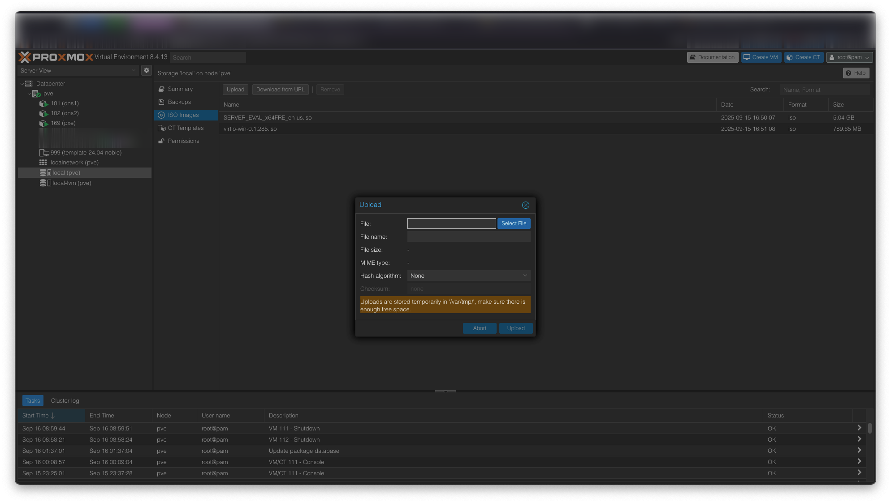

## 2. VM Konfiguration

Im nächsten Schritt setzen wir die VM in PVE auf, auf welcher wir den Windows Server installieren werden.

1. Klicke auf "Create VM", gezeigt im rechten oberen Rand der Web-UI:

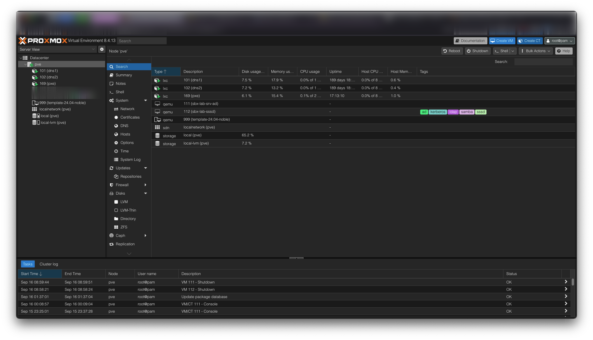

2. Gib der VM eine gewünschte 'VM ID' - diese muss eindeutig sein - und einen Namen:

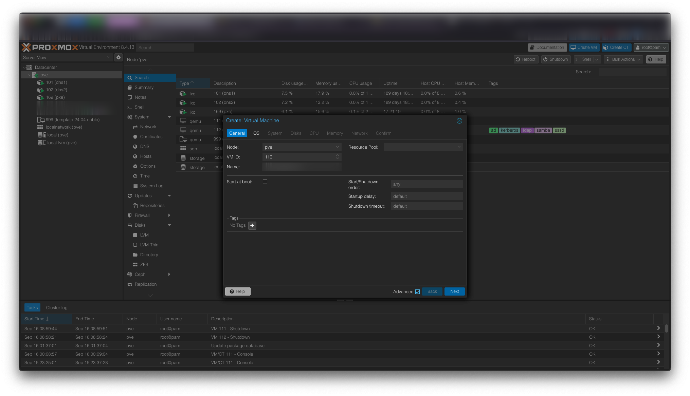

3. Wähle im 'OS' Fenster als ISO Image deine heruntergeladene Windows Server ISO aus, siehe nächstes Bild. Wähle als Guest OS Typ "Microsoft Windows" aus und die entsprechende Version, hier '11/2022/2025'. Zusätzlich kannst du rechts 'Add additional drive for VirtIO drivers' anhaken, um die VirtIO Treiber direkt einzubinden; wähle hier die eben heruntergeladene VirtIO ISO aus, siehe Bild:

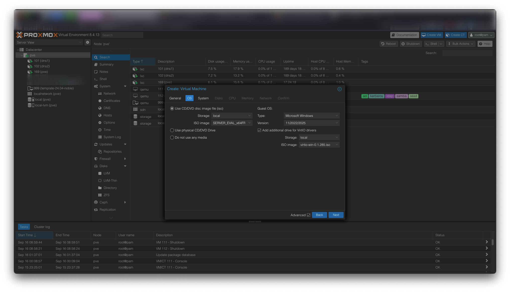

4. Setze die Konfiguration wie im nächsten Bild gezeigt: Machine 'q35', BIOS 'OVMF (UEFI)' mit EFI Disk, TPM v2.0 und 'Qemu Agent' angehakt:

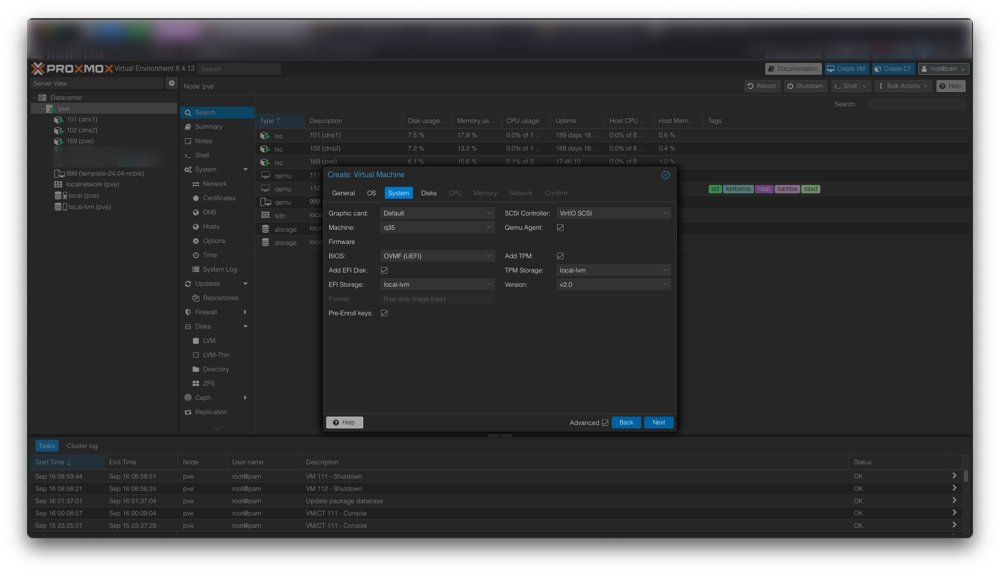

5. Disks: Hier wird die Festplatte der VM angelegt. Ich habe 'VirtIO Block' als Bus genommen, mit 'Discard' und 'IO thread' angehakt. Proxmox empfiehlt für Windows inzwischen 'SCSI' als Bus mit dem Controller 'VirtIO SCSI single'. Beides funktioniert; wichtig ist nur, dass du bei der Installation später den passenden Treiber lädst (siehe Abschnitt 3).

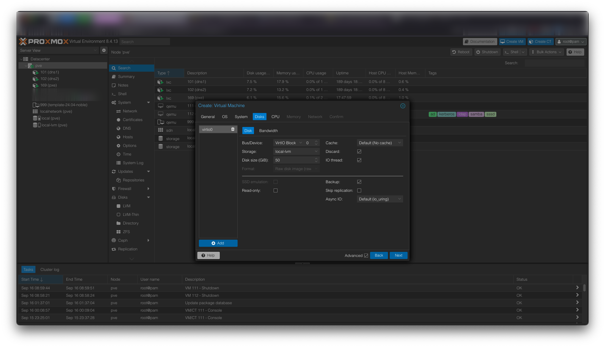

6. CPU: Ein Socket mit 2 Cores, Typ 'host'. Wenn die VM später zwischen Hosts mit unterschiedlichen CPUs migriert werden soll, nimm statt 'host' einen generischen Typ wie 'x86-64-v2-AES'.

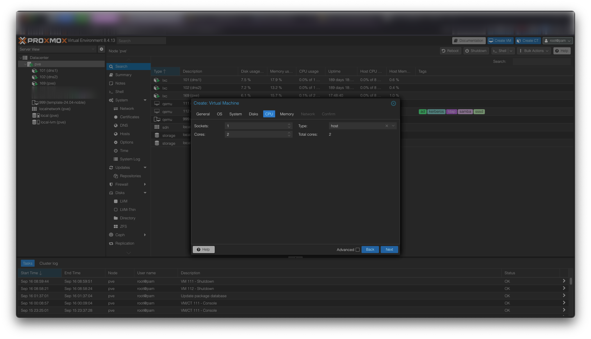

7. Memory: 4096 MiB.

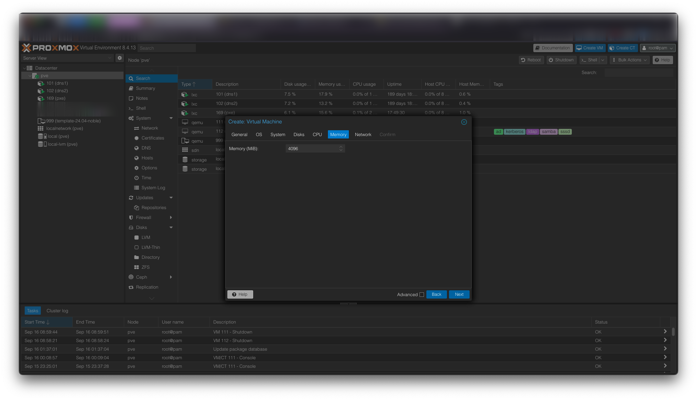

8. Network: Bridge 'vmbr0', Model 'VirtIO (paravirtualized)'.

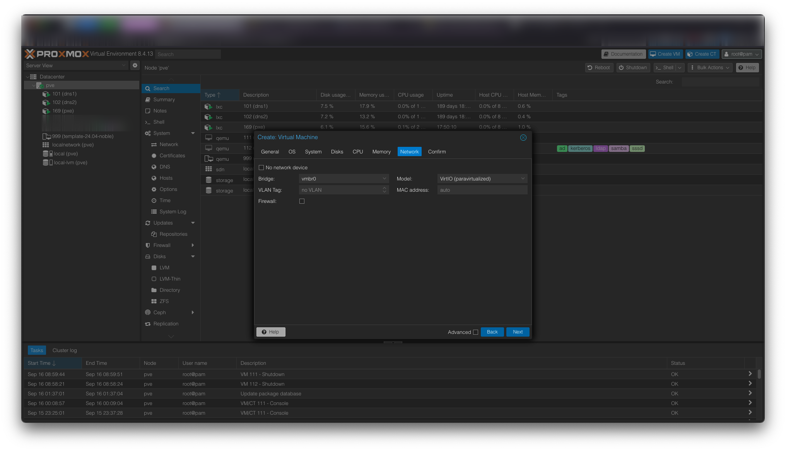

9. Confirm: Überprüfe die Zusammenfassung und klicke auf 'Finish'.

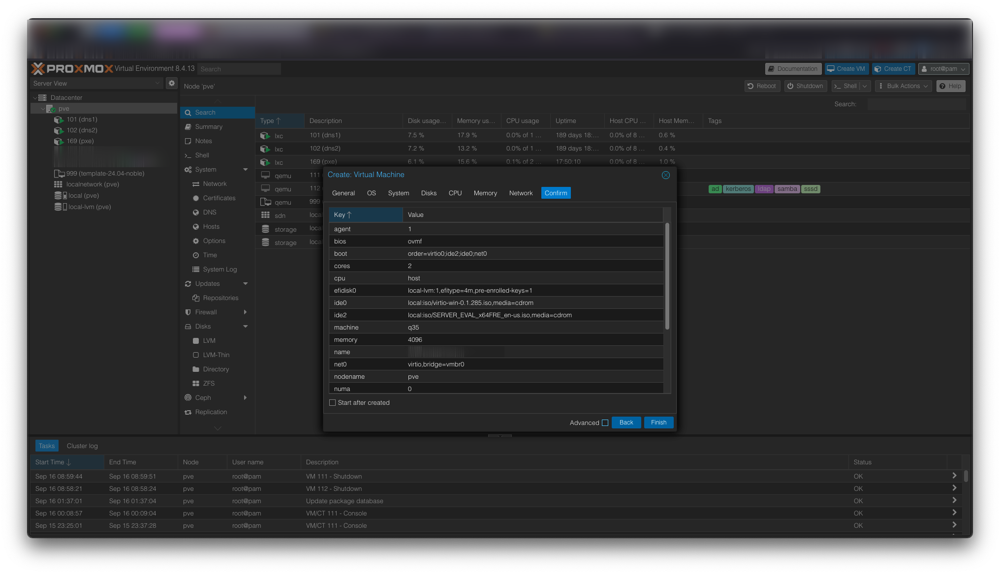

## 3. OS Installation

1. Im nächsten Schritt starten wir die VM und öffnen die Konsole. Beim ersten Boot zeigt die Windows ISO kurz "Press any key to boot from CD or DVD" an; dort muss schnell eine Taste gedrückt werden. Verpasst man das, landet man im UEFI Boot Manager bzw. der UEFI Shell. Starte die Maschine dann über 'Reset' neu und drücke rechtzeitig eine Taste. Danach siehst du das gewohnte Windows Setup. Klicke auf 'Next' und anschließend auf 'Install now':

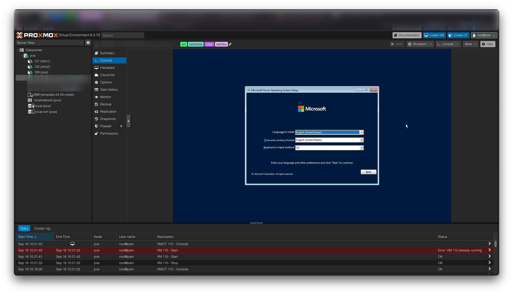

2. Wähle dein gewünschtes Windows Server Betriebssystem aus. Wir wählen hier: 'Windows Server 2022 Standard Evaluation (Desktop Experience)'. Ohne '(Desktop Experience)' wird nur Server Core ohne grafische Oberfläche installiert. Akzeptiere im nächsten Schritt die Lizenzbedingungen.

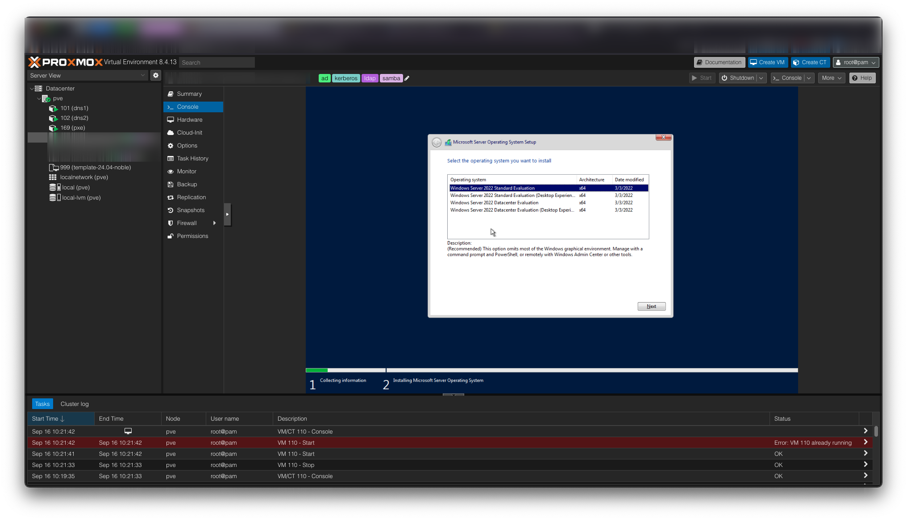

3. Im nächsten Schritt nehmen wir die Partitionierung vor; hier müssen wir zunächst den VirtIO Storage Treiber laden, da Windows die VirtIO Disk sonst nicht erkennt. Wähle hier die 'Custom' Methode aus:

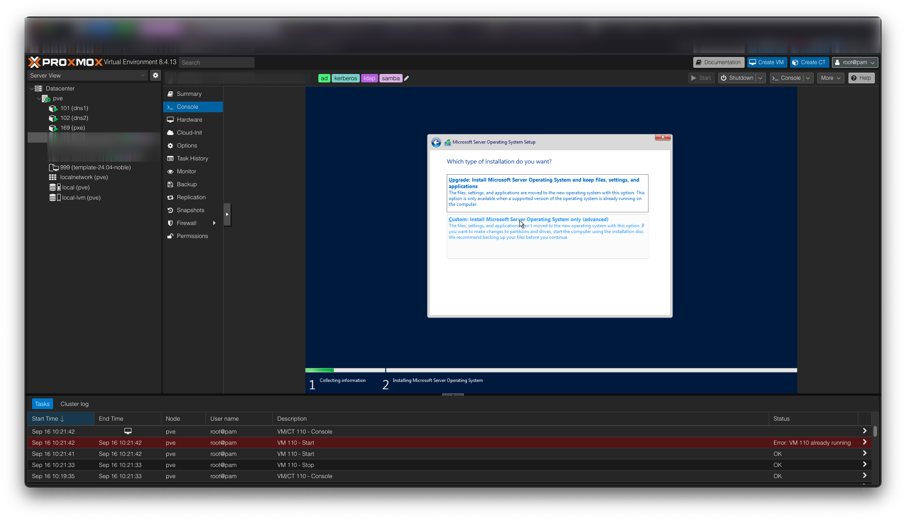

Klicke im nächsten Schritt auf 'Load driver':

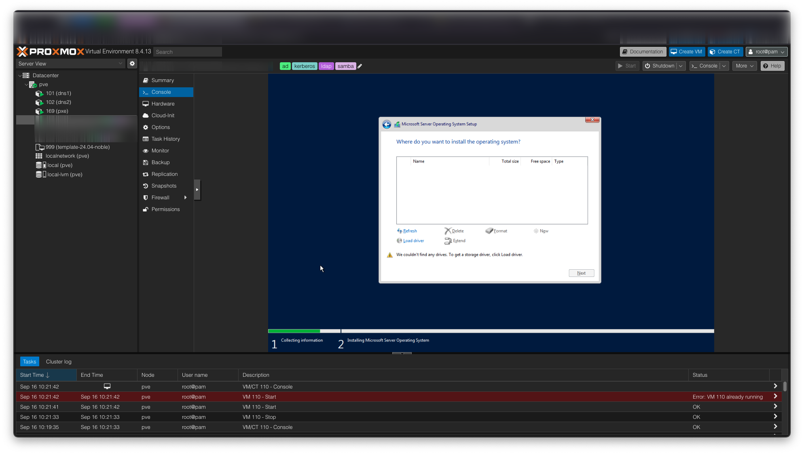

Wähle im nächsten Schritt den Treiber aus, welcher deinem OS entspricht. In unserem Fall ist es der für Version 2022 ('2k22'). Für Windows Server 2025 nimmst du entsprechend '2k25'. Die Liste zeigt hier 'viostor', weil die Disk als 'VirtIO Block' angelegt wurde; bei einer 'SCSI' Disk heißt der Treiber 'vioscsi':

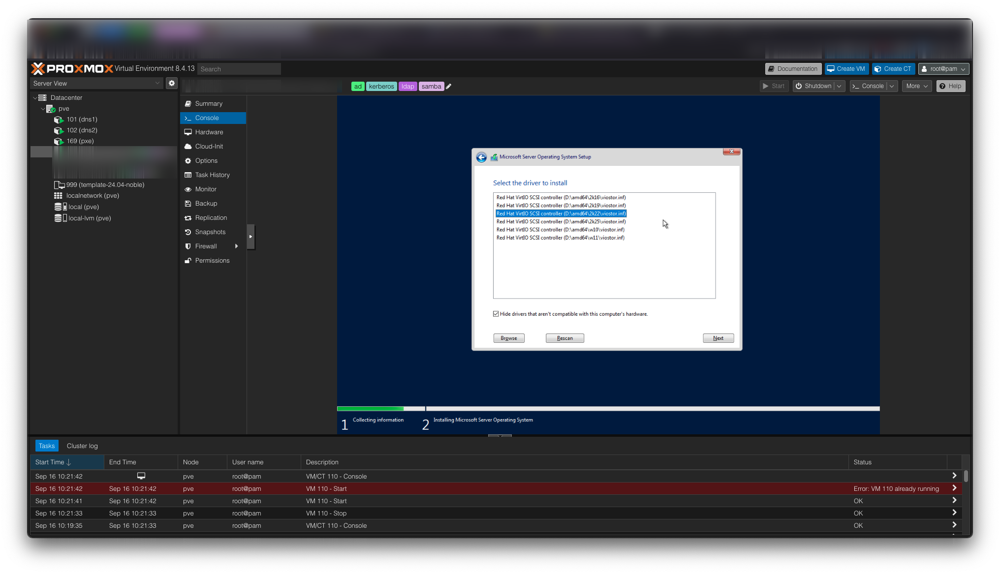

Im Anschluss sollte dir die Festplatte angezeigt werden:

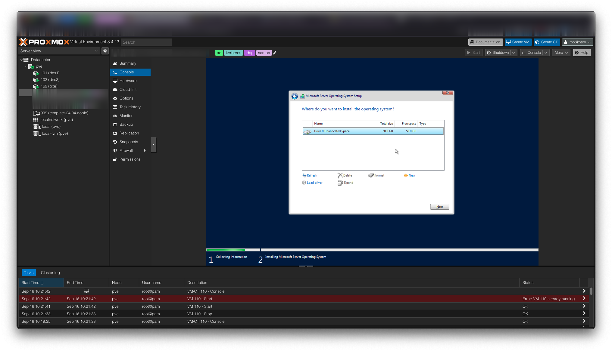

Wähle die Festplatte aus und starte die Installation.

4. Nach Abschluss der Installation sollte der Server neu starten und in deinen neuen Windows Server booten. Du wirst aufgefordert, ein neues Passwort für den lokalen Administrator zu erstellen.

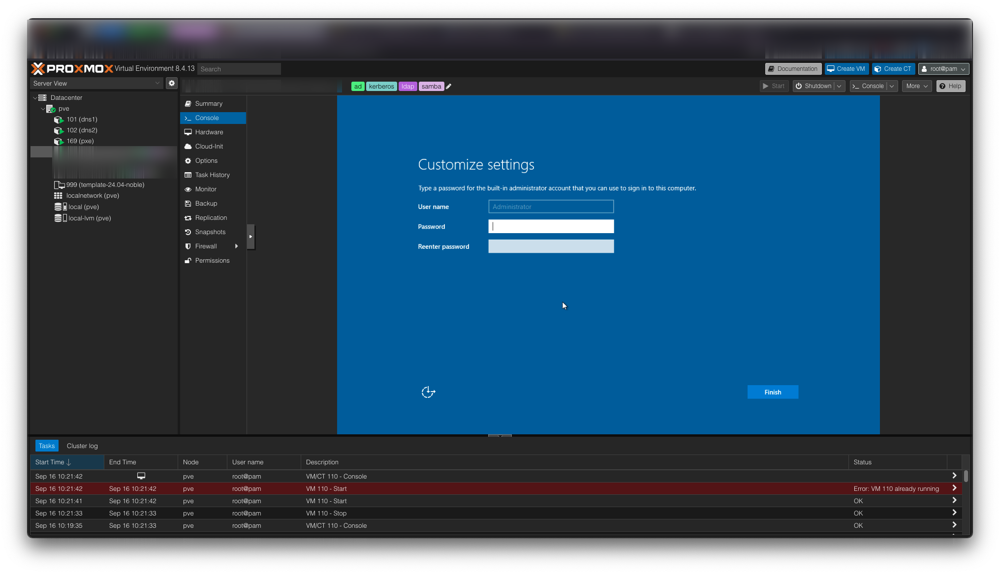

5. Nun kannst du dich anmelden. Das Ctrl+Alt+Delete schickst du über den Button links in der noVNC Konsole:

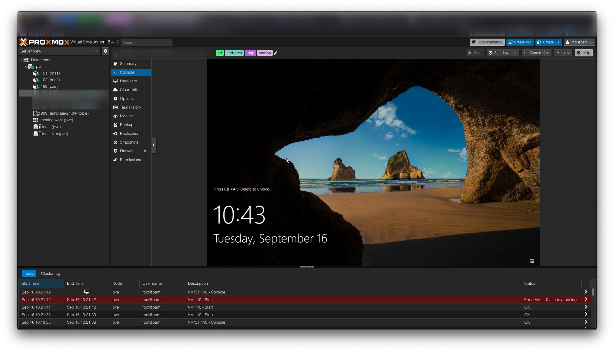

6. Treiber Installation. Melde dich an deinem neuen Server an, öffne den Datei Explorer und öffne das Laufwerk mit der noch eingebundenen VirtIO Treiber ISO:

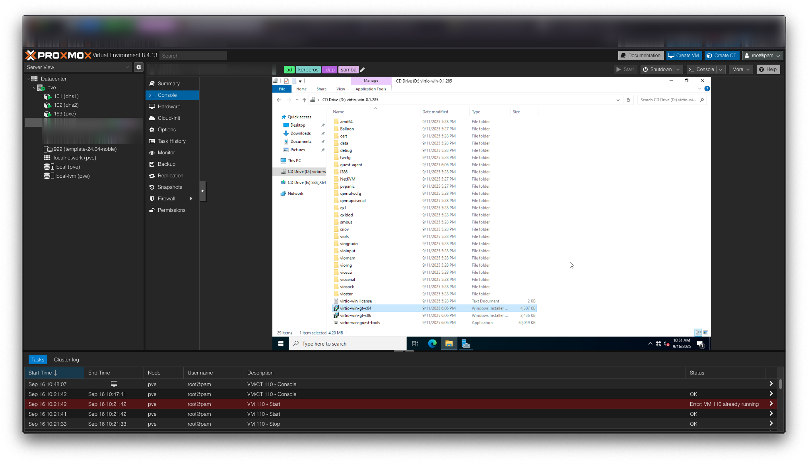

Installiere mit einem Doppelklick die 'virtio-win-gt-x64' Treiber.
Im Anschluss sollte der Server eine Netzwerkverbindung haben. Starte den Server danach neu.

7. Wir installieren noch den QEMU Guest Agent, indem du im Explorer auf der VirtIO ISO den Ordner 'guest-agent' öffnest und die 'qemu-ga-x86_64.msi' installierst:

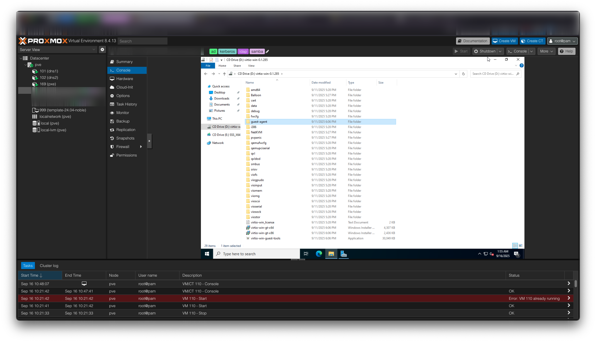

Alternativ installiert 'virtio-win-guest-tools.exe' im Hauptverzeichnis der ISO die Treiber und den Guest Agent in einem Schritt.

Im Anschluss sollten die IP Adressen des Servers in der PVE Web-UI angezeigt werden:

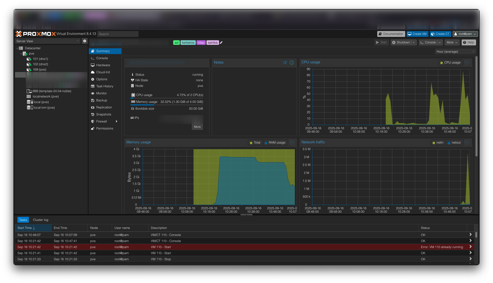

Zum Schluss kannst du die beiden ISOs unter 'Hardware' wieder aus der VM entfernen.

## Unterschiede bei Windows Server 2025

- Das Setup von Windows Server 2025 sieht anders aus als in den Screenshots oben. Die Schritte sind dieselben: Edition wählen, 'Load driver', Treiber aus '2k25' laden, Disk wählen, installieren.
- In PVE 9 ist der Ablauf beim Erstellen der VM derselbe; als OS Version wählst du weiterhin '11/2022/2025'.
- Die Evaluation Version läuft 180 Tage. Für den produktiven Einsatz brauchst du eine reguläre Lizenz.
