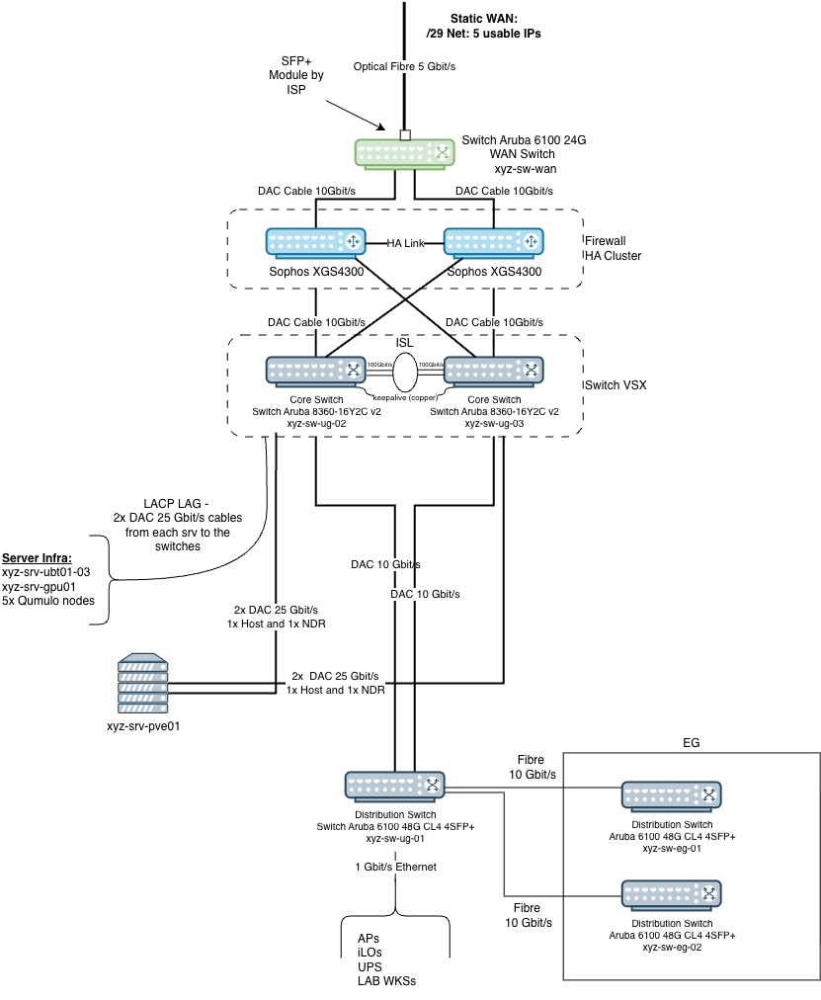
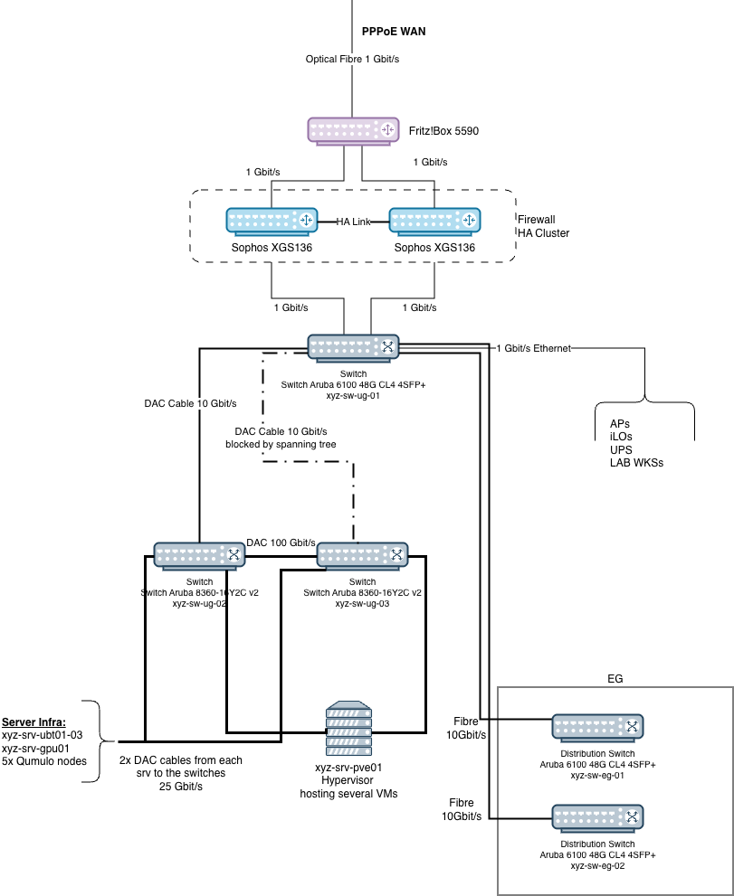

## Introduction

One of our customers asked to have their internet connection upgraded to 5 Gbit/s. Their existing 1 Gbit/s line was saturating and they had begun to notice it. Both connections are symmetric in download and upload, and a symmetric 5 Gbit/s line is still not something you get everywhere in Germany, which made this a project I enjoyed leading.

Their network infrastructure supported 1 Gbit/s at most, so the new line needed a firewall cluster that could sustain it. In the process I rebuilt the whole network infrastructure to get more out of the hardware they already owned: a dedicated WAN switch, a new firewall cluster, and a proper core built from two switches that were already in the rack.

I have not asked the ISP for permission to write about them, so they are not named here. The customer is not named either. Hostnames, IP addresses and anything else identifying have been changed throughout the series.

This article gives a general overview of the project and how the work was structured. It is part 1 of the project [Network infrastructure rebuild for a 5 Gbit/s line]().

## The goal

**The WAN.** Single-strand single-mode fibre from the ISP on a BiDi SFP+, a static /29,
terminating on a small Aruba 6100 24G acting as a dumb layer 2 switch. It exists so that both
firewall nodes can reach the same handover. There is no aggregation on the WAN side: one
10 GbE link per node is already twice the capacity of the line, and the fibre and the switch
are single points of failure regardless.

**The firewall.** Two Sophos XGS 4300 in active-passive HA. Each node reaches the core over a
2 x 10 GbE LACP group with one leg to each core switch, so a node keeps working if either
switch goes away. All internal networks ride that group as tagged VLANs.

**The core.** Two Aruba 8360-16Y2C v2 as a VSX pair: two 100 GbE cables between them as an
inter-switch link, and a keepalive over a separate direct cable between their out-of-band
management ports. VSX is not stacking. Both switches keep their own configuration, their own
management address and their own control plane. What they share is an identity towards
everything below them, which is what lets a single host bond across both chassis.

**Everything below.** The distribution switch reaches the core over a LAG, giving it a single
20 GbE path built from two uplinks that each land on a different core switch. Every server and
every storage node does the same thing on 25 GbE: one leg to each switch, bonded with LACP.

From the core's side every one of those is a multi-chassis LAG, the firewall groups included.
That is the whole point of the VSX pair: a LAG can span both switches. The device at the other
end configures an ordinary LACP bond and never has to know that its two links land in different
chassis.

One thing we deliberately left alone: inter-VLAN routing stays on the firewall instead of
moving to the core. The core would route faster, but every client is on 1 GbE, so the firewall
is nowhere near being the bottleneck, and moving routing there would mean rebuilding the
firewall's inter-VLAN rules as switch ACLs. If traffic between VLANs ever does become a real
bottleneck, that is the moment to revisit it.

## The network before

The old 1 Gbit/s line arrived on a FritzBox, which handed it to the two firewall nodes over
copper. The firewall was a pair of Sophos XGS 136 in active-passive HA. Those are 1 GbE
appliances, so the new line would have arrived and nothing would have got faster. That much was
expected.

Three other things were sitting in the same rack.

The two 8360s, `xyz-sw-ug-02` and `xyz-sw-ug-03`, had been bought for the servers and the
storage cluster and were doing the job of ordinary access switches. Each has sixteen SFP28
ports and two QSFP28 ports, and they were joined to each other by a single 100 GbE cable. That
is a lot of switch to spend on patching servers.

`xyz-sw-ug-01`, the 6100 that carries the desks and the management ports, had one uplink to
each of them. Spanning tree blocked one, which is the only thing spanning tree can do with two
separate links into two separate bridges. So every client packet crossed a single 10 GbE link
while the second sat there as a cold spare. Both cables were already in the rack. Nobody had
aggregated them.

That block had a side effect which mattered later. Traffic between `xyz-sw-ug-01` and
`xyz-sw-ug-03` went the long way round, through `xyz-sw-ug-02` and over the same 100 GbE cable
that was about to become the VSX inter-switch link.

The server and storage bonds were all active-backup. Every one of them had two 25 GbE legs, one
to each 8360, and used a single leg at a time. The other waited for a failure that mostly never
came.

## Planning and execution

Every step was discussed and agreed with the customer beforehand, including the sequence and
the maintenance windows it needed.

We divided the execution into two phases. The first is the internet connection, the firewall
and the switch core: the WAN switch, the new cluster, the VSX pair and the aggregated uplinks.
The second is everything below the core, the server and storage bonds and the detection sensor,
none of which depends on the ISP.

The customer agreed an activation date for the new line with the ISP and told us when it would
be. It was scheduled for the afternoon, so we arrived in the morning to prepare. The ISP also
agreed to leave the old FritzBox line running for a few days afterwards, which meant we could
build the new infrastructure with the old line still available as a backup WAN interface.

That first phase had to happen in a single day on site, because the pieces interlock like
gears. The firewall cluster's LAGs could not exist before the VSX core did, and the core had to
be rebuilt underneath a connection that was still carrying the company's traffic.

It worked. The firewall cluster was migrated onto the old FritzBox line before the new connection existed, which cost a few minutes of downtime that nobody in the building noticed, and the new line came up hours later as a routing change rather than a cutover.

The [next article]() covers the WAN switch, the 5 Gbit/s handover, and building the VSX core that everything else had to land on.

## Resources

Everything referenced across the series, in one place. The individual articles link the subset they actually use.

**Aruba AOS-CX**

- [Aruba VSX configuration guide, AOS-CX 10.13](https://arubanetworking.hpe.com/techdocs/AOS-CX/10.13/PDF/vsx.pdf)
- [Aruba 8360 basic and VSX configuration (random-it-blog.de)](https://random-it-blog.de/posts/aruba-8360-basic-and-vsx-configuration-part-2/)

**Sophos firewall**

- [XGS 4300/4500 operating instructions](https://docs.sophos.com/nsg/hardware/operatinginstructions/xgs/sophos-operating-instructions-xgs-4300-4500.pdf)
- [Backup and restore across models and versions](https://docs.sophos.com/nsg/sophos-firewall/21.5/Help/en-us/webhelp/onlinehelp/AdministratorHelp/BackupAndFirmware/BackupAndRestore/BackupAndRestoreModelsVersions/index.html)
- [Import and export](https://docs.sophos.com/nsg/sophos-firewall/22.0/Help/en-us/webhelp/onlinehelp/AdministratorHelp/BackupAndFirmware/ImportExport/index.html)
- [Link aggregation groups](https://docs.sophos.com/nsg/sophos-firewall/21.5/Help/en-us/webhelp/onlinehelp/AdministratorHelp/Network/Interfaces/NetworkLinkAggregationGroups/index.html)
- [Add a link aggregation group](https://docs.sophos.com/nsg/sophos-firewall/21.5/Help/en-us/webhelp/onlinehelp/AdministratorHelp/Network/Interfaces/NetworkLinkAggregationGroupAdd/index.html)
- [Configure a VLAN interface](https://docs.sophos.com/nsg/sophos-firewall/20.0/Help/en-us/webhelp/onlinehelp/AdministratorHelp/Network/Interfaces/NetworkVLANInterfaceAdd/index.html)
- [Gateways](https://docs.sophos.com/nsg/sophos-firewall/22.0/Help/en-us/webhelp/onlinehelp/AdministratorHelp/Routing/Gateways/index.html)
- [Configure active-passive HA](https://docs.sophos.com/nsg/sophos-firewall/22.0/Help/en-us/webhelp/onlinehelp/HighAvailablityStartupGuide/HAConfiguration/HAQuickHAConfigureActivePassive/index.html)
- [HA prerequisites](https://docs.sophos.com/nsg/sophos-firewall/19.0/Help/en-us/webhelp/onlinehelp/HighAvailablityStartupGuide/AboutHA/HAPrerequisitesStartupGuide/index.html)
- [KBA-000005173: link aggregation in HA](https://support.sophos.com/support/s/article/KBA-000005173?language=en_US)

**Sophos NDR**

- [SPAN settings](https://docs.sophos.com/central/ndr/help/en-us/UserGuide/settings/SPAN/)
- [NDR sensor on Nutanix](https://docs.sophos.com/central/customer/help/en-us/ManageYourProducts/ThreatAnalysisCenter/Integrations/Sophos/NDR/NDRVirtual/NDRonNutanix/index.html)
- [NDR sensor on ESXi and Hyper-V](https://docs.sophos.com/central/customer/help/en-us/ManageYourProducts/ThreatAnalysisCenter/Integrations/Sophos/NDR/NDRVirtual/NDRESXiHyperV/index.html)
- [SophosNDR-Proxmox (GitHub)](https://github.com/BrandonSanders48/SophosNDR-Proxmox)

**Qumulo**

- [Qumulo administrator guide](https://docs.qumulo.com/administrator-guide/)
- [`qq` CLI command guide: login](https://docs.qumulo.com/qq-cli-command-guide/login/login.html)

**Measuring the line**

- [librespeed-cli](https://github.com/librespeed/speedtest-cli)
- [Hetzner speed test file](https://nbg1-speed.hetzner.com/1GB.bin)

---

*This article was written with the assistance of Claude (Anthropic).*
