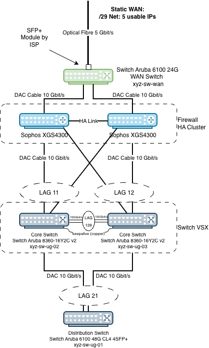

## Introduction

The new line needed somewhere to land, so the WAN switch was configured days beforehand in the
office. We gave it a public address, which meant that once the fibre was plugged in we could
test the line from the switch itself rather than waiting for the firewall behind it to be
ready.

The first thing we needed on site was a working VSX core, so that the LAG interfaces already
prepared on the firewall cluster had something to connect to.

Those two were the first things racked and configured on the day, which is why they come first
here. This article covers the WAN switch, the details of the new connection and building the
VSX core. It is part 2 of the project [Network infrastructure rebuild for a 5 Gbit/s line]().




## The new connection

The ISP delivers the line on a single strand of single-mode fibre with a BiDi SFP+, and hands
over a static /29. Both directions run on one fibre at different wavelengths, which is why
there is one strand rather than the usual pair.

A /29 gives eight addresses, six of them usable. One of those six is the ISP's own gateway, so
five are ours:

| Address | Role |
|---|---|
| `203.0.113.88/29` | handover network |
| `203.0.113.89` | ISP gateway |
| `203.0.113.90` | firewall WAN, shared between the two HA nodes |
| `203.0.113.91` | free |
| `203.0.113.92` | free |
| `203.0.113.93` | free |
| `203.0.113.94` | WAN switch management |
| `203.0.113.95` | broadcast |

The cluster needs only one WAN address because it runs active-passive. The passive node holds no address on that interface at all and takes `.90` over when it becomes active.

The fibre does not go into the firewall. It goes into a small Aruba 6100 24G, and both firewall nodes connect to that. The reason is the HA pair: a cable can only be plugged into one appliance. A dumb layer 2 segment in front of the pair gives both nodes the same handover.

There is no aggregation on the WAN side. One 10 GbE link per node is already twice the capacity of a 5 Gbit/s line, and the fibre and the switch are single points of failure regardless.

We configured both firewalls and the WAN switch with their real addresses in the office beforehand, with the /29 simulated in a lab environment. On the day the WAN side was a cable rather than a configuration change.

## The WAN switch

It is an Aruba 6100 24G 4SFP+, configured as dumb as it can be. Spanning tree is off, because the switch has no redundant path and therefore no loop to resolve. Shutting the unused ports is what stops someone building a loop by miscabling it later.

The switch sits outside the firewall, and it has no out-of-band management port. The only address it can hold is one from the public /29. The original plan was to configure it over the console and then take that address off again, leaving it with no management interface at all.

That plan did not work. The intention had been to wire its console port into a server in the rack and run that server as a serial bridge, so the console would at least be reachable over the network. The 6100 takes USB-C for console, I had brought a USB-C to USB-C cable, and no server in the rack had a port that cable would fit.

So that the switch stays reachable over the network at all, we kept the public address `203.0.113.94` and hardened it instead. SSH is key-only with password authentication disabled, there is no web interface, and a control-plane ACL restricts port 22 to our office's public address.

That is still a management interface on a public address, and I would rather it were not. It collects brute-force attempts the way anything with an open port does, and the ACL is the only thing in front of it. An out-of-band port would solve this. The switch does not have one, and a console server in the rack would solve it too, which is the fix worth coming back to.

One trap if you write such an ACL: an AOS-CX access list has an implicit deny at the end, so one that does not finish with an explicit permit takes away the switch's own ICMP and routing along with everyone else's SSH. Test it from the console before saving.

## VSX is not stacking

The two Aruba 8360-16Y2C v2 were already in the rack doing the work of access switches. The rebuild turns them into a VSX pair.

The first thing to understand is what VSX does not do. It is not stacking. There is no merged control plane and no single configuration. Both switches keep their own config, their own management address, and their own copy of everything. Nothing you type on one appears on the other.

What they share is an identity towards everything below them. They advertise one `system-mac`, which means one spanning tree bridge ID, and they can terminate a link aggregation group whose two member links land in different chassis. That last part is the whole point. A server with one cable to each switch runs an ordinary LACP bond and has no idea its two links reach different hardware.

## The LAGs

Four link aggregation groups go in during this phase. The numbering is arbitrary but
deliberate: the estate reads by tens, so a LAG number tells you what it serves.

| LAG | Purpose | `xyz-sw-ug-02` | `xyz-sw-ug-03` | `xyz-sw-ug-01` |
|---|---|---|---|---|
| 128 | VSX ISL | `1/1/17`, `1/1/18` | `1/1/17`, `1/1/18` | — |
| 21 | uplink to the distribution switch | `1/1/16` | `1/1/16` | `1/1/51`, `1/1/52` |
| 11 | firewall node A | `1/1/15` | `1/1/15` | — |
| 12 | firewall node B | `1/1/7` | `1/1/7` | — |

LAGs 11, 12 and 21 are multi-chassis on the 8360s. On the distribution switch, `lag 21` is a
plain LAG, because that switch does not know it is talking to two chassis and does not need to.
The two ends of the same aggregation are configured differently, and that is normal.

Two things about building them that are easy to get wrong.

**Create them as `multi-chassis` from the start.** An AOS-CX LAG cannot be converted to
multi-chassis afterwards. The switch accepts `multi-chassis` with no VSX configured at all, so
there is no reason not to. If a LAG might ever span both members, declare it now or rebuild it
later.

**Nothing propagates.** Each member needs its own `interface lag N multi-chassis` block and its
own member port assignment, typed by hand on both. A port also refuses to join a LAG while it
still carries its own VLAN configuration, so clear that first.

Adding members to `lag 21` is the step that moves live traffic, so it goes in one link at a
time. Putting both uplinks into the LAG on the core side while the distribution switch still
has two plain ports cuts the core off from everything, including the session you are typing
into.

## Building the VSX pair

The inter-switch link is two 100 GbE cables in `lag 128`, which consumes both QSFP28 ports on
each member. The keepalive is separate: a plain copper cable between the two out-of-band
management ports, carrying a /30 in the management VRF.

The keepalive exists to break a tie. If the ISL goes away, each member needs to know whether
its peer is dead or merely unreachable, and the keepalive is how it tells the difference.
Because it is a different physical path from the ISL, it fails independently.

```
! both members
interface 1/1/17,1/1/18
    no routing
    lag 128
    no shutdown

! xyz-sw-ug-02
vsx
    system-mac 02:00:00:00:01:00
    inter-switch-link lag 128
    role primary
    keepalive peer 10.99.99.2 source 10.99.99.1 vrf mgmt

! xyz-sw-ug-03 — same system-mac, role secondary, keepalive reversed
```

Ping across the keepalive before applying the `vsx` block. VSX will not form over a keepalive
that does not pass traffic, and on the day that cable was the only new one in the step.

## The spanning tree priority

Once VSX is up, both members advertise the same bridge MAC. That means they have to advertise
the same priority as well, or spanning tree sees one bridge disagreeing with itself.

The order matters, and getting it wrong is expensive. Setting the priority on the second switch
*before* VSX is up gives it a better bridge ID than the first one, because its own MAC is the
lower of the two. It takes the root, and the whole estate reconverges around it. So the
priority goes on after the pair is formed and shares a MAC, never before.

```
xyz-sw-ug-03(config)# spanning-tree priority 4
```

## Check the configuration

```
xyz-sw-ug-02# show vsx status
VSX Operational State
---------------------
  ISL channel             : In-Sync
  ISL mgmt channel        : operational
  Config Sync Status      : In-Sync
  NAE                     : peer_reachable
  HTTPS Server            : peer_reachable

Attribute           Local               Peer
------------        --------            --------
ISL link            lag128              lag128
ISL version         2                   2
System MAC          02:00:00:00:01:00   02:00:00:00:01:00
Platform            8360                8360
Software Version    LL.10.10.1030       LL.10.10.1030
Device Role         primary             secondary
```

Both members run the same software version, which VSX requires.

The LACP view is where the design becomes visible. This is trimmed to the four LAGs above:

```
xyz-sw-ug-02# show lacp interfaces

Actor details of all interfaces:
----------------------------------------------------------------------------------
Intf       Aggr       Port  Port  State   System-ID         System Aggr Forwarding
           Name       Id    Pri                             Pri    Key  State
----------------------------------------------------------------------------------
1/1/15     lag11(mc)  15    1     ALFNCD  02:00:00:00:01:00 65534  11   up
1/1/7      lag12(mc)  7     1     ALFNCD  02:00:00:00:01:00 65534  12   up
1/1/16     lag21(mc)  16    1     ALFNCD  02:00:00:00:01:00 65534  21   up
1/1/17     lag128     18    1     ALFNCD  aa:bb:cc:00:00:02 65534  128  up
1/1/18     lag128     19    1     ALFNCD  aa:bb:cc:00:00:02 65534  128  up
```

`ALFNCD` is the healthy state: active, aggregable, in sync, collecting and distributing.

The interesting column is the system ID. The three multi-chassis LAGs present
`02:00:00:00:01:00`, the shared VSX system MAC, because to the device on the other end they
come from one logical switch. The ISL presents `aa:bb:cc:00:00:02`, this switch's own MAC,
because the ISL is an ordinary LAG between two neighbours rather than something spanning them.
The distinction is the whole architecture in one column.

Spanning tree agrees:

```
xyz-sw-ug-02# show spanning-tree
Spanning tree status      : Enabled Protocol: MSTP

MST0
  Root ID    Priority   : 16384
             MAC-Address: 02:00:00:00:01:00
             This bridge is the root

  Bridge ID  Priority  : 16384
             MAC-Address: 02:00:00:00:01:00

Port         Role           State      Cost    Priority  Type
------------ -------------- ---------- ------- --------- ----------
lag11        Designated     Forwarding 2000    64        P2P
lag12        Designated     Forwarding 2000    64        P2P
lag21        Designated     Forwarding 2000    64        P2P
```

Both switches report this, and both say they are the root, because as far as spanning tree is
concerned they are one bridge.

## The blocked uplink

Before the rebuild, the distribution switch had two uplinks, one to each 8360. Spanning tree
blocked one of them, which is the only thing it can do with two separate links into two
separate bridges. Every client packet crossed a single 10 GbE link while the second sat there
as a cold spare.

Once both uplinks are members of `lag 21`, spanning tree sees one logical port instead of two
competing ones, and the block disappears. The individual ports stop appearing in the spanning
tree table at all, which is visible above: there is a `lag21` row and no `1/1/16` row.

The result is 20 GbE active and active, and a path that survives losing either core switch
without a reconvergence at all rather than with one.

## Syncing the core switches

Because the two members keep separate configurations, anything that should match has to be
typed twice. That is fine on the day and a slow leak afterwards, because drift is silent.

Say a VLAN ends up allowed on `lag 11` on one member and not the other. The link stays up and
LACP stays happy, so the bond never fails over. Frames just go nowhere on whichever leg the
hash picks, and it looks like an application problem rather than a network one.

Configuration sync closes that. The primary pushes whatever you mark to the secondary, and the
secondary's copy becomes managed rather than independently editable. Objects are marked
individually:

```
! on the primary only
vlan 10
    vsx-sync

interface lag 11
    vsx-sync vlans
```

and whole feature categories are listed in the `vsx` context:

```
vsx
    vsx-sync lldp snmp ssh stp-global time
```

Every VLAN and every multi-chassis LAG carries a marker. The ISL does not, because it is not a
multi-chassis LAG.

Two things to know before turning it on. The markers go on the **primary only**; marking the
same object on both members is what produces a sync conflict. And enabling sync makes the
primary authoritative, so if the two members differ in something you are about to sync, the
secondary's version is replaced. Diff the two configurations first, resolve any real difference
by hand, and then enabling sync changes nothing at all on the day you do it. That is the goal.

One thing sync does not do: it does not propagate physical port-to-LAG membership. Which port
belongs to which LAG stays per-member by design, which is why the by-hand work earlier in this
article is still by hand.

`show vsx status` is not the check for this. It reports VSX's own state and will say In-Sync
whether or not your two configurations agree. The command that actually compares them is:

```
xyz-sw-ug-02# show vsx config-consistency
Configurations              Local                              Peer
------------------          ------                             ------
Software Version            LL.10.10.1030                      LL.10.10.1030
System MAC                  02:00:00:00:01:00                  02:00:00:00:01:00
System Profile              Aggregation-Leaf                   Aggregation-Leaf

VSX VLAN List
-------------
Local ISL VLANs : 1 10 20 30 40 50 60 70 80
Peer ISL VLANs  : 1 10 20 30 40 50 60 70 80

STP Configurations          Local                              Peer
------------------          ------                             ------
STP Mode                    mstp                               mstp
MST Config Digest           AC36177F50283CD4B83821D8AB26DE62   AC36177F50283CD4B83821D8AB26DE62
```

The MST config digest is the useful line. It is a hash of the whole spanning tree region
configuration, so two switches showing the same digest genuinely match rather than merely
looking similar.

## Appendix: detailed configuration

Everything above, in the order it was actually typed. Port numbers and VLAN IDs are specific to
this estate, so read rather than paste.

### The WAN switch

Over the console, before it goes in the rack.

```
interface 1/1/1-1/1/24
    shutdown

interface vlan 1
    ip address 203.0.113.94/29

ip route 0.0.0.0/0 203.0.113.89

no spanning-tree

no ssh password-authentication
user admin authorized-key <key>
ssh maximum-auth-attempts 3
ssh login-grace-time 30

apply access-list ip <name> control-plane vrf default
```

Adjust the shutdown range to leave the fibre port and the two firewall ports enabled. The web
server is never turned on. Write the control-plane ACL with an explicit permit at the end, and
test it from the console before saving.

### Pre-staging, the evening before

None of this moves traffic. The LAG interfaces are created empty, and the member ports are
added `shutdown`.

```
! xyz-sw-ug-02 and xyz-sw-ug-03

interface lag 11 multi-chassis
    no shutdown
    no routing
    lacp mode active
    vlan trunk native 1
    vlan trunk allowed 10,20,30,40,50,60,70,80

interface lag 12 multi-chassis
    no shutdown
    no routing
    lacp mode active
    vlan trunk native 1
    vlan trunk allowed 10,20,30,40,50,60,70,80

interface 1/1/15
    shutdown
    no vlan access 60
    no routing
    lag 11

interface 1/1/7
    shutdown
    no vlan access 60
    no routing
    lag 12

interface lag 128
    no shutdown
    no routing
    lacp mode active
    vlan trunk native 50
    vlan trunk allowed all

interface lag 21 multi-chassis
    no shutdown
    no routing
    lacp mode active
    vlan trunk native 50
    vlan trunk allowed all
```

Native VLAN 1 on the two firewall LAGs is deliberate and different from every other trunk here.
The firewall side of that aggregation carries its own untagged address, VLAN 1 is not in the
allowed list, so those frames go nowhere. Do not tidy it to native 50.

The keepalive addresses go on the out-of-band ports, which hold no address otherwise:

```
! xyz-sw-ug-02
interface mgmt
    ip static 10.99.99.1/30

! xyz-sw-ug-03
interface mgmt
    ip static 10.99.99.2/30
```

There is no `no ip dhcp` on that interface. Setting a static address clears DHCP by itself.

The distribution switch runs a different firmware branch, where `no routing` is not a valid
interface command at all and ports are layer 2 already:

```
! xyz-sw-ug-01 — plain LAG, not multi-chassis
interface lag 21
    no shutdown
    lacp mode active
    vlan trunk native 50
    vlan trunk allowed all
```

### VSX

Cable the second 100 GbE link and the keepalive first, then ping across the keepalive before
going further.

```
! both members
interface 1/1/17,1/1/18
    no routing
    lag 128
    no shutdown

! xyz-sw-ug-02
vsx
    system-mac 02:00:00:00:01:00
    inter-switch-link lag 128
    role primary
    keepalive peer 10.99.99.2 source 10.99.99.1 vrf mgmt

! xyz-sw-ug-03
vsx
    system-mac 02:00:00:00:01:00
    inter-switch-link lag 128
    role secondary
    keepalive peer 10.99.99.1 source 10.99.99.2 vrf mgmt
```

Ping across the keepalive before applying the `vsx` block:

```
! from xyz-sw-ug-02
ping 10.99.99.2 vrf mgmt
```

Only once `show vsx status` is clean, and not before:

```
xyz-sw-ug-03(config)# spanning-tree priority 4
```

### The uplink LAG

One link at a time, and check LACP between the two halves.

```
! xyz-sw-ug-02
interface 1/1/16
    lag 21
    no shutdown

! xyz-sw-ug-01
interface 1/1/52
    lag 21
    no shutdown
```

`show lacp interfaces` on both ends, then repeat for `xyz-sw-ug-03` `1/1/16` and
`xyz-sw-ug-01` `1/1/51`.

### The firewall LAGs

The members were built during pre-staging and left shut, so bringing the firewall onto the core
is one command per port.

```
! xyz-sw-ug-02 and xyz-sw-ug-03
interface 1/1/15
    no shutdown

interface 1/1/7
    no shutdown
```

`write memory` on every switch you touched, then `checkpoint diff startup-config
running-config` to confirm there is nothing left unsaved.

### Configuration sync

Added later rather than on the build day, and only after confirming both members already
matched. On the primary alone.

```
configure terminal

! every VLAN
vlan 10
    vsx-sync
    exit
! repeat for 20, 30, 40, 50, 60, 70, 80

! every multi-chassis LAG, but not lag 128 — the ISL is not one
interface lag 11
    vsx-sync vlans
    exit
! repeat for lag 12, 21, 31-35, 41-44, 51

! whole feature categories
vsx
    vsx-sync lldp snmp ssh stp-global time
    exit

end
write memory
```

Then check it took, and that the two members agree:

```
show vsx status              # Config Sync Status: In-Sync
show vsx config-consistency
```

## Resources

- [Aruba VSX configuration guide, AOS-CX 10.13](https://arubanetworking.hpe.com/techdocs/AOS-CX/10.13/PDF/vsx.pdf)
- [Aruba 8360 basic and VSX configuration (random-it-blog.de)](https://random-it-blog.de/posts/aruba-8360-basic-and-vsx-configuration-part-2/)

---

*This article was written with the assistance of Claude (Anthropic).*
